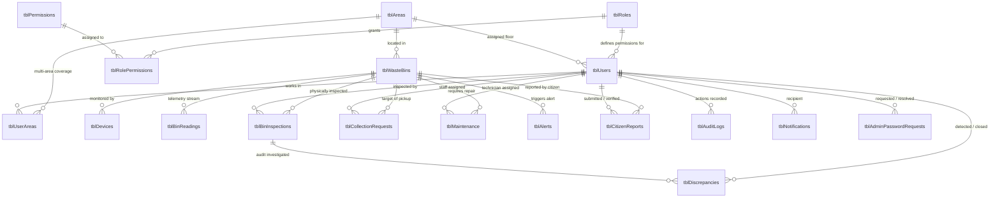

# 03. THIẾT KẾ CƠ SỞ DỮ LIỆU & TỪ ĐIỂN DỮ LIỆU (DATABASE SCHEMA & ERD)
## ĐỒ ÁN MÔN HỌC PRJ301 – ĐẠI HỌC FPT TP. HỒ CHÍ MINH
### CƠ SỞ DỮ LIỆU: SMARTWASTEDB (MICROSOFT SQL SERVER 2019 / 2022)

---

## 1. Sơ Đồ Thực Thể Liên Kết (Entity-Relationship Diagram - ERD)

Toàn bộ cơ sở dữ liệu `SmartWasteDB` được chuẩn hóa đạt dạng **3NF (Third Normal Form)**, loại bỏ triệt để hiện tượng dư thừa dữ liệu và đảm bảo toàn vẹn tham chiếu thông qua hệ thống khóa ngoại chặt chẽ:

---

## 2. Từ Điển Dữ Liệu Chi Tiết Các Bảng (Data Dictionary)

### 2.1. Nhóm Phân Quyền & Người Dùng (RBAC & Users)

#### Bảng 1: `tblRoles` (Danh mục vai trò người dùng)
| Tên Cột | Kiểu Dữ Liệu | Ràng Buộc | Diễn Giải Nghiệp Vụ |
|:---|:---|:---|:---|
| `roleID` | `VARCHAR(10)` | **PK**, NOT NULL | Mã vai trò: `SAD`, `ADM`, `MGR`, `SUP`, `STF`, `TEC`, `AUD`, `USR` |
| `roleName` | `NVARCHAR(50)` | NOT NULL | Tên hiển thị đầy đủ của nhóm vai trò |
| `description` | `NVARCHAR(255)` | NULL | Mô tả phạm vi quyền hạn và trách nhiệm |

#### Bảng 2: `tblPermissions` (Danh mục quyền chức năng)
| Tên Cột | Kiểu Dữ Liệu | Ràng Buộc | Diễn Giải Nghiệp Vụ |
|:---|:---|:---|:---|
| `permissionID`| `VARCHAR(50)` | **PK**, NOT NULL | Mã quyền: `MANAGE_USERS`, `MANAGE_BINS`, `AUDIT_DISCREPANCY`... |
| `permissionName`| `NVARCHAR(100)`| NOT NULL | Tên quyền chức năng chi tiết |
| `module` | `VARCHAR(50)` | NOT NULL | Phân hệ trực thuộc (Auth, Asset, Operations, Audit...) |

#### Bảng 3: `tblRolePermissions` (Ma trận phân quyền vai trò - chức năng)
| Tên Cột | Kiểu Dữ Liệu | Ràng Buộc | Diễn Giải Nghiệp Vụ |
|:---|:---|:---|:---|
| `roleID` | `VARCHAR(10)` | **PK, FK** &rarr; `tblRoles` | Vai trò được cấp quyền |
| `permissionID`| `VARCHAR(50)` | **PK, FK** &rarr; `tblPermissions` | Quyền chức năng được trao |

#### Bảng 4: `tblUsers` (Tài khoản người dùng hệ thống)
| Tên Cột | Kiểu Dữ Liệu | Ràng Buộc | Diễn Giải Nghiệp Vụ |
|:---|:---|:---|:---|
| `userID` | `VARCHAR(50)` | **PK**, NOT NULL | Mã định danh người dùng (`USR-001`, `SAD-001`...) |
| `fullName` | `NVARCHAR(100)` | NOT NULL | Họ và tên đầy đủ |
| `email` | `VARCHAR(100)` | UNIQUE, NOT NULL | Địa chỉ thư điện tử dùng để đăng nhập |
| `password` | `VARCHAR(255)` | NOT NULL | Mật khẩu băm PBKDF2WithHmacSHA256 (20.000 vòng lặp) |
| `phoneNumber` | `VARCHAR(20)` | NULL | Số điện thoại liên lạc |
| `roleID` | `VARCHAR(10)` | **FK** &rarr; `tblRoles` | Nhóm vai trò của tài khoản |
| `areaID` | `VARCHAR(50)` | **FK** &rarr; `tblAreas` | Tầng học / Phân vùng làm việc chính |
| `status` | `BIT` | DEFAULT 1 | Trạng thái tài khoản: 1 = Active, 0 = Locked |
| `failedLogins`| `INT` | DEFAULT 0 | Số lần đăng nhập sai liên tiếp (Khóa khi đạt 5) |
| `createdDate` | `DATETIME` | DEFAULT GETDATE()| Ngày tạo tài khoản |

---

### 2.2. Nhóm Hạ Tầng & Bản Đồ Số (Campus Hierarchy & Assets)

#### Bảng 5: `tblAreas` (Phân vùng 5 tầng học Đại học FPT TP.HCM)
| Tên Cột | Kiểu Dữ Liệu | Ràng Buộc | Diễn Giải Nghiệp Vụ |
|:---|:---|:---|:---|
| `areaID` | `VARCHAR(50)` | **PK**, NOT NULL | Mã tầng học (`AREA-00` đến `AREA-04`) |
| `areaName` | `NVARCHAR(100)` | NOT NULL | Tên tầng: *Ground Floor (Tầng G)*, *First Floor (Tầng 1)*... |
| `description` | `NVARCHAR(255)` | NULL | Mô tả khối giảng đường, phòng Lab, thư viện trong tầng |

#### Bảng 6: `tblWasteBins` (12 Điểm thùng rác thông minh)
| Tên Cột | Kiểu Dữ Liệu | Ràng Buộc | Diễn Giải Nghiệp Vụ |
|:---|:---|:---|:---|
| `binID` | `VARCHAR(50)` | **PK**, NOT NULL | Mã hệ thống nội bộ (`BIN-001` &rarr; `BIN-012`) |
| `binCode` | `VARCHAR(20)` | UNIQUE, NOT NULL | Mã dán thực tế trên nắp thùng (`BIN-G-01`, `BIN-1-01`...) |
| `location` | `NVARCHAR(255)` | NOT NULL | Vị trí cụ thể (Hành lang, sảnh, cửa phòng học) |
| `latitude` | `DECIMAL(10,6)` | NOT NULL | Tọa độ vĩ độ GPS khuôn viên Đại học FPT TP.HCM |
| `longitude` | `DECIMAL(10,6)` | NOT NULL | Tọa độ kinh độ GPS khuôn viên Đại học FPT TP.HCM |
| `capacity` | `FLOAT` | DEFAULT 120.0 | Dung tích thực tế của thùng (Lít) |
| `currentFill` | `FLOAT` | CHECK (0 &le; c &le; 100)| Mức rác hiện tại cập nhật thời gian thực (%) |
| `status` | `VARCHAR(20)` | CHECK IN (...) | Trạng thái: `Active`, `Full`, `Maintenance` |
| `areaID` | `VARCHAR(50)` | **FK** &rarr; `tblAreas` | Tầng học bố trí thùng rác |
| `lastEmptied` | `DATETIME` | NULL | Mốc thời gian gần nhất thùng được đổ rác |

#### Bảng 7: `tblDevices` (Thiết bị vi điều khiển ESP32)
| Tên Cột | Kiểu Dữ Liệu | Ràng Buộc | Diễn Giải Nghiệp Vụ |
|:---|:---|:---|:---|
| `deviceID` | `VARCHAR(50)` | **PK**, NOT NULL | Mã định danh thiết bị ngoại vi (`DEV-001`...) |
| `deviceName` | `NVARCHAR(100)` | NOT NULL | Tên mô-đun (ESP32 NodeMCU WROOM-32) |
| `macAddress` | `VARCHAR(30)` | UNIQUE, NULL | Địa chỉ MAC Wi-Fi của chip ESP32 |
| `binID` | `VARCHAR(50)` | **FK** &rarr; `tblWasteBins` | Thùng rác được gắn thiết bị đo |
| `batteryLevel`| `INT` | DEFAULT 100 | Tỷ lệ pin dự phòng của thùng rác (%) |
| `status` | `VARCHAR(20)` | DEFAULT 'Active' | Trạng thái kết nối phần cứng |
| `lastPing` | `DATETIME` | NULL | Thời điểm gần nhất ESP32 gửi nhịp tim mạng |

---

### 2.3. Nhóm Viễn Trắc & Vận Hành Thu Gom (Telemetry & Logistics)

#### Bảng 8: `tblBinReadings` (Dòng dữ liệu đo đạc cảm biến siêu âm)
| Tên Cột | Kiểu Dữ Liệu | Ràng Buộc | Diễn Giải Nghiệp Vụ |
|:---|:---|:---|:---|
| `readingID` | `INT IDENTITY` | **PK**, NOT NULL | Khóa chính tự tăng |
| `binID` | `VARCHAR(50)` | **FK** &rarr; `tblWasteBins` | Mã thùng rác gửi số đo |
| `fillPercent` | `INT` | 0 &le; val &le; 100 | Mức rác tính toán được theo sóng siêu âm (%) |
| `measuredAt` | `DATETIME` | DEFAULT GETDATE()| Dấu thời gian vi điều khiển ghi nhận |

#### Bảng 9: `tblCollectionRequests` (Lệnh điều phối thu gom rác)
| Tên Cột | Kiểu Dữ Liệu | Ràng Buộc | Diễn Giải Nghiệp Vụ |
|:---|:---|:---|:---|
| `requestID` | `VARCHAR(50)` | **PK**, NOT NULL | Mã lệnh thu gom (`COL-001`...) |
| `binID` | `VARCHAR(50)` | **FK** &rarr; `tblWasteBins` | Thùng rác cần thu gom |
| `staffID` | `VARCHAR(50)` | **FK** &rarr; `tblUsers` | Nhân viên thu gom (STF) được giao việc |
| `status` | `VARCHAR(20)` | `Pending`, `In_Progress`, `Completed`, `Skipped` | Tiến độ thực thi |
| `priority` | `VARCHAR(20)` | `Low`, `Medium`, `High`, `Emergency` | Mức độ ưu tiên thu gom |
| `createdDate` | `DATETIME` | DEFAULT GETDATE()| Thời điểm phát sinh lệnh |
| `completedDate`| `DATETIME` | NULL | Thời điểm nhân viên bấm hoàn thành |
| `notes` | `NVARCHAR(MAX)` | NULL | Ghi chú của nhân viên hoặc hệ thống |

#### Bảng 10: `tblAlerts` (Cảnh báo sự cố thời gian thực)
| Tên Cột | Kiểu Dữ Liệu | Ràng Buộc | Diễn Giải Nghiệp Vụ |
|:---|:---|:---|:---|
| `alertID` | `VARCHAR(50)` | **PK**, NOT NULL | Mã cảnh báo (`ALT-001`...) |
| `binID` | `VARCHAR(50)` | **FK** &rarr; `tblWasteBins` | Thùng rác phát sinh cảnh báo |
| `alertType` | `VARCHAR(50)` | `High_Fill`, `Sensor_Conflict`, `Sensor_Fault` | Phân loại cảnh báo |
| `message` | `NVARCHAR(255)` | NOT NULL | Nội dung chi tiết thông báo cảnh báo |
| `isResolved` | `BIT` | DEFAULT 0 | 0 = Đang cảnh báo, 1 = Đã xử lý xong |
| `createdDate` | `DATETIME` | DEFAULT GETDATE()| Thời điểm kích hoạt cảnh báo |

---

### 2.4. Nhóm Giám Sát, Sai Lệch & Bảo Trì (Inspection, Audit & Maintenance)

#### Bảng 11: `tblBinInspections` (Biên bản kiểm tra thực địa)
| Tên Cột | Kiểu Dữ Liệu | Ràng Buộc | Diễn Giải Nghiệp Vụ |
|:---|:---|:---|:---|
| `inspectionID`| `VARCHAR(50)` | **PK**, NOT NULL | Mã biên bản giám sát (`INSP-001`...) |
| `binID` | `VARCHAR(50)` | **FK** &rarr; `tblWasteBins` | Thùng rác được kiểm tra |
| `inspectorID` | `VARCHAR(50)` | **FK** &rarr; `tblUsers` | Giám sát viên (SUP) thực hiện đợt kiểm tra |
| `actualFillPercent` | `INT` | 0 &le; val &le; 100 | Mức rác quan sát mắt thấy trong lòng thùng (%) |
| `sensorFillPercent` | `INT` | 0 &le; val &le; 100 | Mức rác cảm biến đang báo về trên hệ thống (%) |
| `discrepancyPercent`| `INT` | NOT NULL | Độ sai lệch: ActualFill - SensorFill (%) |
| `physicalCondition` | `NVARCHAR(50)` | NOT NULL | Tình trạng thùng: *Good, Damaged, Obstructed* |
| `actionTaken` | `NVARCHAR(100)`| NOT NULL | Biện pháp xử lý: *Cleaned_Sensor, Ticket...* |
| `inspectionDate` | `DATETIME` | DEFAULT GETDATE()| Ngày giờ thực hiện kiểm tra |

#### Bảng 12: `tblDiscrepancies` (Hồ sơ điều tra sai lệch dữ liệu)
| Tên Cột | Kiểu Dữ Liệu | Ràng Buộc | Diễn Giải Nghiệp Vụ |
|:---|:---|:---|:---|
| `discrepancyID`| `VARCHAR(50)` | **PK**, NOT NULL | Mã hồ sơ sai lệch (`DISC-001`...) |
| `title` | `NVARCHAR(255)` | NOT NULL | Tóm tắt dấu hiệu bất thường cảm biến |
| `targetEntity` | `VARCHAR(50)` | NOT NULL | Đối tượng nghi vấn (`tblBinInspections`...) |
| `severity` | `VARCHAR(20)` | `Critical`, `High`, `Medium`, `Low` | Mức độ nghiêm trọng của sự cố |
| `status` | `VARCHAR(20)` | `Open`, `Investigating`, `Resolved`, `Closed` | Tiến độ xử lý của Auditor |
| `detectedBy` | `VARCHAR(50)` | **FK** &rarr; `tblUsers` | Cán bộ giám sát hoặc hệ thống phát hiện |
| `investigationNotes` | `NVARCHAR(MAX)`| NULL | Nhật ký điều tra hiện trường và kỹ thuật |
| `conclusionNotes` | `NVARCHAR(MAX)`| NULL | Kết luận nguyên nhân và quyết định đóng hồ sơ |

#### Bảng 13: `tblMaintenance` (Phiếu sửa chữa bảo trì phần cứng)
| Tên Cột | Kiểu Dữ Liệu | Ràng Buộc | Diễn Giải Nghiệp Vụ |
|:---|:---|:---|:---|
| `maintenanceID`| `VARCHAR(50)` | **PK**, NOT NULL | Mã phiếu bảo trì (`MNT-001`...) |
| `binID` | `VARCHAR(50)` | **FK** &rarr; `tblWasteBins` | Thùng rác cần sửa chữa |
| `technicianID` | `VARCHAR(50)` | **FK** &rarr; `tblUsers` | Kỹ thuật viên (TEC) nhận nhiệm vụ |
| `maintenanceType`| `VARCHAR(50)` | `Sensor_Check`, `Repair`, `Replace_Battery` | Loại hình sửa chữa |
| `status` | `VARCHAR(20)` | `Pending`, `In_Progress`, `Completed`, `Cancelled` | Tiến độ sửa chữa |
| `description` | `NVARCHAR(MAX)` | NOT NULL | Mô tả hư hỏng hoặc nguyên nhân phát sinh |
| `scheduledDate`| `DATETIME` | NULL | Ngày hẹn sửa chữa |
| `completedDate`| `DATETIME` | NULL | Thời điểm hoàn tất sửa chữa |

#### Bảng 14: `tblCitizenReports` (Phản ánh của cộng đồng sinh viên)
| Tên Cột | Kiểu Dữ Liệu | Ràng Buộc | Diễn Giải Nghiệp Vụ |
|:---|:---|:---|:---|
| `reportID` | `VARCHAR(50)` | **PK**, NOT NULL | Mã phản ánh (`REP-001`...) |
| `citizenID` | `VARCHAR(50)` | **FK** &rarr; `tblUsers` | Sinh viên / Giảng viên gửi phản ánh |
| `binID` | `VARCHAR(50)` | **FK** &rarr; `tblWasteBins` | Thùng rác bị phản ánh |
| `title` | `NVARCHAR(200)` | NOT NULL | Tiêu đề sự cố phản ánh |
| `description` | `NVARCHAR(MAX)` | NOT NULL | Mô tả chi tiết hiện trạng thùng rác |
| `imageUrl` | `VARCHAR(255)` | NULL | Đường dẫn ảnh chụp hiện trường |
| `status` | `VARCHAR(20)` | `Under Review`, `Verified`, `Resolved`, `Rejected` | Tiến độ xử lý |
| `citizenRating`| `INT` | 1 &le; val &le; 5 | Điểm đánh giá mức độ hài lòng (Số sao) |
| `createdDate` | `DATETIME` | DEFAULT GETDATE()| Thời điểm gửi phản ánh |

#### Bảng 15: `tblAuditLogs` (Nhật ký kiểm toán an ninh bất biến)
| Tên Cột | Kiểu Dữ Liệu | Ràng Buộc | Diễn Giải Nghiệp Vụ |
|:---|:---|:---|:---|
| `logID` | `BIGINT IDENTITY`| **PK**, NOT NULL | Khóa chính tự tăng |
| `userID` | `VARCHAR(50)` | NULL | Mã tài khoản thực hiện tác vụ |
| `action` | `VARCHAR(100)` | NOT NULL | Tên hành vi: `LOGIN`, `CREATE_INSPECTION`, `UPDATE_BIN`... |
| `targetTable` | `VARCHAR(50)` | NOT NULL | Bảng dữ liệu bị thay đổi |
| `recordID` | `VARCHAR(50)` | NULL | Khóa chính của bản ghi bị tác động |
| `oldValue` | `NVARCHAR(MAX)` | NULL | Dữ liệu trước khi chỉnh sửa |
| `newValue` | `NVARCHAR(MAX)` | NULL | Dữ liệu sau khi chỉnh sửa |
| `ipAddress` | `VARCHAR(50)` | NULL | Địa chỉ IP máy khách thực hiện |
| `logTimestamp` | `DATETIME` | DEFAULT GETDATE()| Dấu thời gian bất biến |
